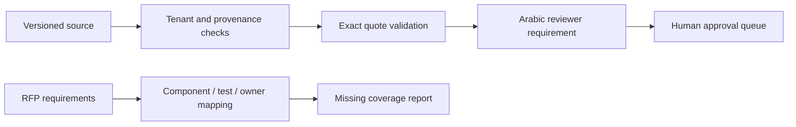

> **Proprietary - All Rights Reserved.** Licensed to Sandeep Grover. No reuse, copying, modification, or distribution without prior written permission. See LICENSE.

# Bilingual document architecture controls

An illustrative proposal demonstrator by Dr. Sandeep Grover using synthetic data only. It is not a deployed document platform, OCR engine, translator, security certification, legal analysis or a delivered client system.



## Run

```bash
python -m pip install -r requirements.txt
python main.py
python -m pytest -q
```

The runnable sample checks document tenant, version, exact source quote, confidence range, language, page and SHA256. NFC normalization preserves Arabic text. Arabic output requires an explicit review flag and remains eligible only for further human approval. Confidence is supplied synthetic metadata, not a calibrated model score. The sample does not sanitize malicious documents or claim prompt-injection detection. A production design needs isolated parsing, restricted tools, role-based access, retained audit events and independent security tests.

The traceability function reports missing components, acceptance tests, owners and unknown requirement IDs. Requirements must be classified as confirmed, assumption or recommendation. This demonstrates how an editable RFP-to-vendor handover can expose decisions and gaps without inventing compliance conclusions.
